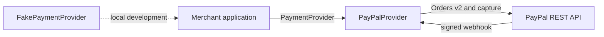

# @hypa/paypal-agent

MIT-licensed contracts and a PayPal Orders v2 payment provider. This package is
standalone and does not depend on Hypa services.

## Local demo

With Node.js 20 or newer, install the package dependencies and run the fake
provider demo. It does not require PayPal credentials or Hypa services.

```sh
npm install
npm run demo
```

The demo creates a checkout, prints its URL, captures the fake payment, and
prints the resulting status. Use the PayPal adapter below to create a real
sandbox checkout.

## Configuration

Copy `.env.example` to `.env` in your application and provide the PayPal sandbox
client ID, secret, and webhook ID. Never commit credentials. Use
`PAYPAL_ENVIRONMENT=live` only for a production PayPal app.

```ts
import { PayPalProvider } from '@hypa/paypal-agent';

const provider = new PayPalProvider({
  clientId: process.env.PAYPAL_CLIENT_ID!,
  clientSecret: process.env.PAYPAL_CLIENT_SECRET!,
  webhookId: process.env.PAYPAL_WEBHOOK_ID!,
  environment: 'sandbox',
});
```

Call `createCheckout` from a server and redirect the buyer to its `checkoutUrl`.
After approval, call `capture` from your server. Keep credentials out of browser
and mobile clients. `verifyWebhook` checks the transmission with PayPal's
webhook signature verification endpoint before returning a normalized event.

## Architecture



All monetary values crossing the provider contract are decimal strings in an
ISO 4217 currency. The adapter uses PayPal request IDs for idempotent writes.
